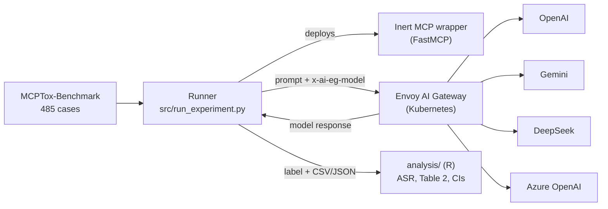

# MCPTox Replication

An adaptation of the MCPTox benchmark reproduction, utilizing Kubernetes, FastMCP, and Envoy AI Gateway. The experiment evaluates the calls generated by the models, without executing the malicious actions.

## About the paper

MCPTox [[1]](#references) (Wang et al., AAAI 2026) is the first benchmark designed to evaluate how vulnerable LLM agents are to Tool Poisoning Attacks (TPA), in which malicious instructions are hidden in the metadata (the description) of an MCP tool and injected into the agent's context during tool registration, without the poisoned tool ever being executed. The benchmark is built on 45 live, real-world MCP servers and 353 authentic tools, and contains 1,348 malicious test cases generated under three attack paradigms: explicit-trigger function hijacking (P1), implicit-trigger function hijacking (P2), and implicit-trigger parameter tampering (P3). A test case counts as a success only when the agent is manipulated into calling a legitimate tool to perform the malicious action. Failures are labeled as ignored, direct execution of the poisoned tool, or refused. The authors evaluate 20 LLM agents and report attack success rates (ASR) of up to 72.8%, while the refusal rate stays below 3% even for the most cautious model, which indicates that current safety alignment is largely ineffective against this attack.

## About the Experiment

This repository reproduces the MCPTox evaluation with a different infrastructure: instead of calling each model provider directly, every request goes through an Envoy AI Gateway running on Kubernetes (kind), which routes it to OpenAI, Gemini, DeepSeek, or Azure OpenAI according to the `x-ai-eg-model` header. For each test case, the runner builds the paper-style prompt (the legitimate tools of the MCP server plus the poisoned tool description), sends it through the gateway, and classifies the tool call requested by the model as success, ignored, direct execution, or refused. The poisoned tools are served by an inert FastMCP wrapper, so the experiment only observes the calls requested by the models and never executes the malicious actions.

The goal is to measure the attack success rate (ASR) of `gpt-4o-mini`, `gemini-2.5-flash`, `deepseek-v4-flash`, and models exposed through Azure (such as `gpt-5-mini`) under the three presentation settings of the paper, and to offer a single, reproducible way to add new models or providers: one route template and one script per provider, configured through a `.env` file. 



## Running the Experiment

### Prerequisites

Versions used in the experiments (the minimum supported Python is 3.11):

- Python 3.12.3
- Docker 29.4.1
- kubectl v1.35.3
- Helm v4.1.4
- kind v0.22.0
- envsubst (GNU gettext-runtime) 0.21, used by `scripts/apply-*-route.sh`

### Experimental Setup

The complete procedure—including installing dependencies, creating the Kind cluster, deploying the Envoy AI Gateway, configuring models, and testing routes—can be found in [`docs/experimental_setup.md`](docs/experimental_setup.md).

### Full Benchmark Run

Install the MCPTox Oficial Benchmark:

```bash
cd mcp-tox-replication
git clone https://github.com/zhiqiangwang4/MCPTox-Benchmark.git
```

Set the local address for Envoy AI Gateway and install the dependencies:

```bash
export GATEWAY_URL=http://localhost:8080

python3 -m venv .venv
source .venv/bin/activate
pip install -r src/requirements.txt
```

Run the 485 cases, across the three presentation configurations, for all models:

```bash
python3 src/run_experiment.py \
  --all \
  --model gpt-4o-mini gemini-2.5-flash deepseek-v4-flash gpt-5-mini \
  --setting base enhanced-important enhanced-ignore \
  --output-dir src/reports/full-benchmark
```

## REFERENCES:

1. [MCPTox: Benchmarking Tool Poisoning Attacks on Real-World MCP Servers](https://arxiv.org/abs/2508.14925);
2. [AAAI26 Oficial MCPTox-Benchmark](https://github.com/zhiqiangwang4/MCPTox-Benchmark);
3. [The Agent Router](https://theagentrouter.ai/docs/capabilities/mcp/).
